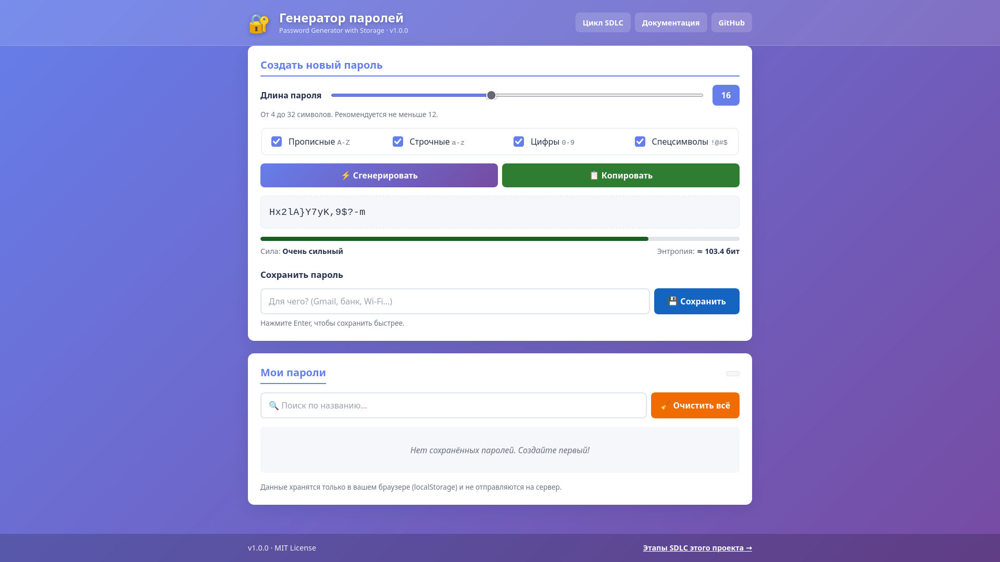
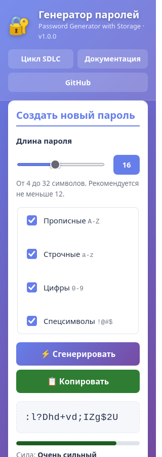
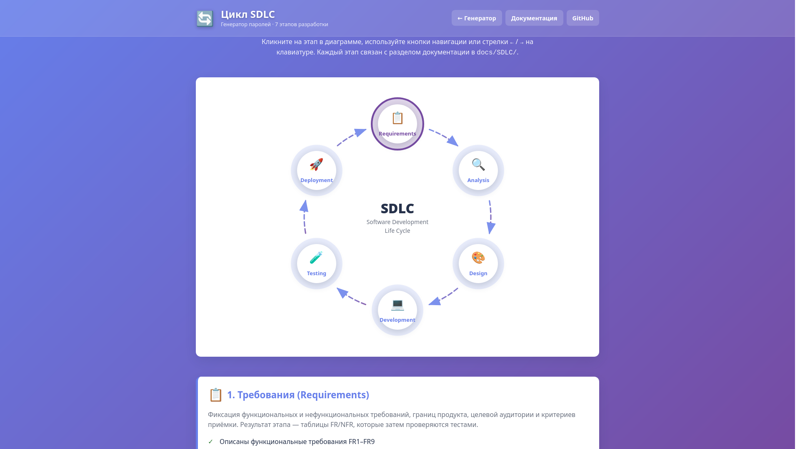

# Руководство пользователя

**Password Generator with Storage · версия 1.0.0**

Генератор паролей с локальным хранилищем: создаёт криптографически стойкие
пароли, показывает их силу в битах и сохраняет выбранные в браузере.

- 🌐 **Онлайн:** https://almight71.github.io/password-generator/
- 📁 **Локально:** откройте `src/index.html` двойным кликом
- 📖 **Документы:** [README](../README.md) · [Архитектура](ARCHITECTURE.md) · [API](API.md)

> **Важно о безопасности.** Пароли хранятся в `localStorage` вашего браузера
> и никуда не отправляются. Данные видны только на этом устройстве в этом
> браузере, но не зашифрованы — очистка данных сайта удалит их навсегда.
> Делайте резервные копии нужных паролей (скопируйте и сохраните в
> менеджере паролей или в защищённом файле).

---

## 1. Интерфейс

| Область | Что там |
|---|---|
| **Генератор пароля** | поле с паролем, индикатор силы, биты энтропии, кнопки «Сгенерировать», «Копировать» |
| **Настройки генерации** | длина (4–32) и четыре набора символов |
| **Хранение паролей** | поле «Название», кнопка «Сохранить», поиск, счётчик, таблица |
| **Цикл SDLC** | ссылка на интерактивную диаграмму процесса разработки |

Ни один из данных не покидает устройство: сеть не используется.

---

## 2. Как сгенерировать пароль

1. Установите длину ползунком (по умолчанию **16**).
2. Отметьте нужные наборы символов — минимум один обязателен.
3. Пароль обновляется **автоматически** при любом изменении настроек.
4. Кнопка «Сгенерировать» выдаёт новый пароль с теми же настройками.

### Уровни силы

Сила считается по энтропии Шеннона: `bits = длина × log₂(размер алфавита)`.

| Уровень | Порог | Что означает на практике |
|---|---|---|
| 🔴 Очень слабый | 0 бит | подбирается мгновенно — не используйте |
| 🟠 Слабый | ≥ 28 бит | ломается перебором за минуты |
| 🟡 Средний | ≥ 44 бит | приемлем только для временных сервисов |
| 🟢 Сильный | ≥ 64 бит | годится для большинства аккаунтов |
| 🟢 Очень сильный | ≥ 88 бит | рекомендуемый уровень; 16 символов полного алфавита дают **103 бита** |

Полоса под паролем заполняется пропорционально 128 битам.
Текст справа показывает точное значение: `≈ 103.4 бит`.

### Установка

Наборы символов:

| Набор | Символы | Кол-во |
|---|---|---|
| Заглавные буквы | `A–Z` | 26 |
| Строчные буквы | `a–z` | 26 |
| Цифры | `0–9` | 10 |
| Спецсимволы | `!@#$%^&*()_+-=[]{}\|;:,.<>?` | 26 |

При снятии последнего оставшегося чекбокса он автоматически возвращается
с подсказкой «Нужен хотя бы один набор символов».

---

## 3. Как сохранить пароль

1. Нажмите **«Копировать»** и вставьте пароль куда нужно.
2. В поле **«Название»** опишите, для чего он (например, `Почта`).
   От 2 до 100 символов, недопустимы `< > " ' `` ` ``.
3. Нажмите **«Сохранить»** (или `Enter` в поле названия).

Пароль появится в таблице с маской `••••••••`, уровнем силы и датой.
Индикатор «Всего: N» обновится. Данные останутся после перезагрузки страницы.

---

## 4. Работа с сохранёнными паролями

| Действие | Как |
|---|---|
| **Показать пароль** | кнопка 👁 в строке — пароль раскрывается, повторное нажатие маскирует |
| **Скопировать** | кнопка 📋 в строке |
| **Удалить одну запись** | кнопка 🗑 → подтверждение в диалоге |
| **Очистить всё** | кнопка «Очистить все» → подтверждение |
| **Найти** | введите часть названия в поле поиска — фильтр мгновенный, без регистра |

В модальном окне подтверждения: `Escape` или «Отмена» — отказ,
«Удалить» — действие выполнено. Фокус всегда возвращается на прежнюю кнопку.

---

## 5. Частые вопросы

**Почему после очистки данных сайта всё исчезло?**
Пароли лежат в `localStorage`. Очистка данных браузера похожа на удаление
файла — восстановить их нельзя. Это осознанное ограничение продукта без сервера.

**Работает ли в приватном окне?**
Да, но `localStorage` может быть недоступен — тогда приложение переключается
на память вкладки и предупреждает об этом в консоли. Записи пропадут
при закрытии окна.

**Можно ли открыть файл напрямую, без сервера?**
Да: `src/index.html` полностью работает по `file://`. Единственное отличие —
копирование использует резервный механизм, поскольку Clipboard API
требует HTTPS.

**Почему не работает копирование?**
Браузер должен быть на HTTPS или `localhost`. Если вы на `file://`,
скопируйте пароль вручную выделением.

**Поменяется ли сила, если добавить длину?**
Да: уровень никогда не понижается при росте длины с тем же алфавитом
(проверено тестом TC13).

**Как очистить конкретную запись, не трогая остальные?**
Кнопка 🗑 в её строке — «Очистить все» удаляет хранилище целиком.

---

## 6. Диаграмма SDLC

Отдельная страница показывает цикл жизненного цикла программного продукта,
по которому создан генератор.

Управление:

| Действие | Результат |
|---|---|
| Клик по узлу | открывает панель этапа и подсвечивает узел |
| `←` / `→` | предыдущий / следующий этап |
| `Home` / `End` | первый / последний этап |
| `Tab` | обход всех интерактивных узлов |
| `Escape` | закрывает открытую панель |

Каждый этап содержит: номер, название, ключевые артефакты (документы) и ссылку
на соответствующий документ в репозитории.

---

## 7. Требования к браузеру

| | Минимум |
|---|---|
| Браузер | Chrome, Edge, Firefox, Safari последних двух версий |
| JavaScript | обязателен |
| HTTPS | рекомендуется (обязателен для Clipboard API) |
| Память | не требуется (работают Web Crypto и localStorage) |

Старые браузеры без поддержки `let`/`classList` (например, IE 11)
не поддерживаются.

---

## 8. Горячие клавиши

| Клавиша | Контекст | Действие |
|---|---|---|
| `Enter` | поле «Название» | сохранить пароль |
| `Escape` | модальное окно | отмена |
| `Enter` | модальное окно | подтверждение |
| `←` `→` `Home` `End` | страница диаграммы | навигация по этапам |

---

## 9. Что дальше

- [USER_GUIDE](USER_GUIDE.md) — вы здесь
- [Архитектура](ARCHITECTURE.md) — как устроен продукт
- [API](API.md) — как использовать модули из кода
- [Документация SDLC](SDLC/01_REQUIREMENTS.md) — требования, анализ, дизайн,
  разработка, тестирование, развёртывание, поддержка
- Исходный код и Issues: https://github.com/Almight71/password-generator
